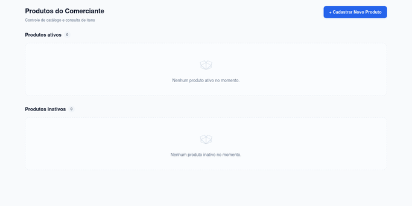

# Avaliação Individual P1 - Desenvolvimento Webmobile
**Universidade Federal do Tocantins (UFT)**  
**Campus Universitário de Palmas**  
**Bacharelado em Ciência da Computação**  
**Disciplina:** GRA.0734 - Desenvolvimento webmobile  
**Docente:** Jackson Gomes de Souza  

---

## Identificação do Aluno
- **Nome Completo:** Laurinda Nhaga Mona
- **Matrícula:** [2020111950]
- **Repositório:** [https://github.com/nhangamona/Prova_web.git](https://github.com/nhangamona/Prova_web.git)
- **Plataforma Testada:** Web (Google Chrome / Node.js v22.22.1 / Linux) e React Native com Expo SDK 57

---
## 1. Visão Geral do Projeto

Aplicativo desenvolvido para pequenos comerciantes cadastrarem e consultarem os produtos que oferecem, alternando sua situação entre ativo e inativo. 

### Tecnologias Utilizadas
- **React Native** com **Expo** (SDK 57)
- **TypeScript** (tipagem estrita com `strict: true`)
- **Expo Router** com navegação em **Stack** no layout raiz
- **React Context API** como fonte única de verdade compartilhada
- **Safe Area Context** e **KeyboardAvoidingView** para acessibilidade visual e usabilidade com teclado aberto

---

## 2. Instruções de Instalação e Execução

### Pré-requisitos
- Node.js versão 18+ (testado na v22.22.1)
- npm versão 9+

### Passo a passo para execução

1. Clone o repositório ou acesse a pasta do projeto:
   ```bash
   cd Prova_web
   ```

2. Instale as dependências:
   ```bash
   npm install
   ```

3. Para executar na plataforma Web:
   ```bash
   npm run web
   ```
   O aplicativo estará disponível no navegador no endereço `http://localhost:8081`.

4. Para executar com o Expo Go (Android / iOS):
   ```bash
   npx expo start
   ```

5. Verificação de Tipos TypeScript (Critério F):
   ```bash
   npx tsc --noEmit
   ```

---

## 3. Verificação de Tipos e Cenários de Teste

### 3.1 Resultado da Verificação TypeScript
Comando executado:
```bash
npx tsc --noEmit
```
**Resultado:** Código de saída `0` (Zero erros encontrados). Todo o código TypeScript está em conformidade com as regras estritas de tipagem (`strict: true`).

### 3.2 Conferência Funcional (Tabela 2 do Roteiro de Avaliação)

| # | Cenário | Ações Realizadas | Resultado Obtido | Evidência (Captura de Tela) | Status |
|---|---|---|---|:---:|:---:|
| **1** | **Partes vazias** | Aplicação inicia sem cadastros prévios. | Exibe mensagens explicativas em ambas as seções: "Nenhum produto ativo cadastrado no momento." e "Nenhum produto inativo cadastrado no momento." | [📸 Ver Captura](docs/evidencias/01_cenario_1_partes_vazias.png) | Aprovado |
| **2** | **Cadastro ativo** | Cadastrado "Arroz 1 kg", preço "7,50", situação Ativo. | Adicionado na seção "Produtos ativos" com preço formatado em R$ 7,50. Redirecionado para tela inicial e formulário limpo. | [📸 Ver Captura](docs/evidencias/03_cenario_2_cadastro_ativo.png) | Aprovado |
| **3** | **Cadastro inativo** | Cadastrado "Café 250 g", preço "12.90", situação Inativo. | Adicionado exclusivamente na seção "Produtos inativos" com preço formatado em R$ 12,90. | [📸 Ver Captura](docs/evidencias/04_cenario_3_cadastro_inativo.png) | Aprovado |
| **4** | **Entrada inválida** | Testadas entradas: nome vazio, só espaços, preço vazio, abc, 0, -5, 12abc e 12,345. | Todas as tentativas foram recusadas com mensagens de erro específicas e descritivas junto aos campos. Os valores digitados foram rigorosamente preservados. | [📸 Ver Captura](docs/evidencias/02_cenario_4_entrada_invalida.png) | Aprovado |
| **5** | **Desativação** | Acessado "Arroz 1 kg" pelo item da lista; clicado em "Desativar produto". | Situação alterou para "Inativo" e o botão mudou para "Ativar produto", mantendo-se na tela de detalhes. Ao voltar, "Arroz 1 kg" figura exclusivamente em inativos. | [📸 Detalhe](docs/evidencias/05_cenario_5_desativacao_detalhe.png) / [📸 Lista](docs/evidencias/06_cenario_5_desativacao_lista.png) | Aprovado |
| **6** | **Reativação** | Acessado "Arroz 1 kg" em inativos; clicado em "Ativar produto". | Retornou para "Produtos ativos". "Café 250 g" permaneceu inalterado em "Produtos inativos". | [📸 Detalhe](docs/evidencias/07_cenario_6_reativacao_detalhe.png) / [📸 Lista](docs/evidencias/08_cenario_6_reativacao_lista.png) | Aprovado |
| **7** | **Identidade e navegação** | Cadastrado outro "Arroz" com preço "9". Alternada a situação de apenas um deles. | Ambos mantêm identificadores distintos (id), preços próprios (R$ 7,50 e R$ 9,00) e alternância de situação independente. | [📸 Ver Captura](docs/evidencias/09_cenario_7_identidade_dois_produtos.png) | Aprovado |
| **8** | **Id inexistente** | Acessada rota com ID ausente (ex: /produtos/inexistente-123). | Exibida tela com aviso "Produto não encontrado" e botão funcional "Retornar à tela inicial". O app permanece plenamente utilizável. | [📸 Ver Captura](docs/evidencias/10_cenario_8_id_inexistente.png) | Aprovado |
| **9** | **Retorno sem histórico** | Acessada rota dinâmica diretamente sem navegação anterior. | Ação de retorno utiliza tratamento com fallback inteligente, redirecionando com sucesso para a tela inicial. | [📸 Ver Captura](docs/evidencias/11_cenario_9_retorno_sem_historico.png) | Aprovado |

### 3.3 Demonstração em Vídeo / Animação dos Cenários (Critério de Entrega Opcional)
Conforme previsto na Seção 5 da avaliação (*"Capturas de tela ou vídeo podem complementar a entrega"*), foi gerada a gravação animada de demonstração contínua da execução dos testes:



---

## 4. Respostas às Quatro Perguntas (Seção 9 - Explicação Individual)

### Pergunta 1: Onde o provider está montado? Por que essa posição permite compartilhar a lista entre cadastro, tela inicial e detalhe?
**Resposta:**  
O ProdutosProvider está montado no arquivo app/_layout.tsx, envolvendo diretamente o componente Stack do Expo Router no layout raiz da aplicação.

Essa posição é fundamental porque no ecossistema React e Expo Router, o escopo do contexto segue a árvore hierárquica de componentes. Como o layout raiz é o componente pai ancestral de todas as rotas filhas (app/index.tsx, app/cadastro.tsx e app/produtos/[id].tsx), qualquer tela montada na pilha de navegação descende diretamente do ProdutosProvider. Isso permite que todas as telas compartilhem a mesmíssima instância do estado e suas funções de atualização através do hook useProdutos, garantindo consistência imediata dos dados em todas as rotas.

---

### Pergunta 2: Quais dados ficam no estado local, quais ficam no provider e quais são derivados? Indiquem exemplos do aplicativo.
**Resposta:**
1. **Os que ficam no Estado Local (Local State):**
   - Dados temporários de um único componente, necessários durante o preenchimento ou validação antes de serem persistidos no estado global.
   - *Exemplos:* No formulário de cadastro (app/cadastro.tsx), os dados digitados e controlados via useState: nome (string), preco (string), ativo (boolean), além dos estados de erro erroNome, erroPreco e o indicador submetido.
2. **Os que ficam no Estado no Provider (Dados Globais):**
   - A fonte única da verdade compartilhada que deve permanecer acessível por múltiplas telas ao longo de toda a sessão de uso.
   - *Exemplos:* No arquivo src/context/ProdutosContext.tsx a lista central de produtos gerenciada via useState com array inicial vazio.
3. **Os Dados Derivados (Derived Data):**
   - Informações calculadas dinamicamente em tempo de execução a partir do estado primário, sem necessidade de duplicação em novo estado, prevenindo inconsistências de sincronização.
   - *Exemplos:*
     - No arquivo src/context/ProdutosContext.tsx, as listas produtosAtivos e produtosInativos, calculadas via useMemo a partir da filtragem da lista central pelo campo ativo.
     - Na tela de detalhes (app/produtos/[id].tsx), o produto selecionado obtido através da função obterProdutoPorId, derivada da busca na lista do contexto.

---

### Pergunta 3: Como a rota identifica o produto? Expliquem por que o detalhe consulta o contexto em vez de receber uma cópia dos dados.
**Resposta:**  
A rota identifica o produto através do parâmetro dinâmico de caminho do Expo Router no arquivo app/produtos/[id].tsx. Ao navegar para a rota de produto, a tela de detalhes obtém esse parâmetro via hook useLocalSearchParams.

O componente de detalhe consulta o contexto (função obterProdutoPorId) em vez de receber uma cópia estática do produto por dois motivos cruciais de arquitetura de software:
1. **Evitar Estado Obsoleto (Stale State):** Se o produto fosse passado como objeto por parâmetro de rota, a tela de detalhes teria uma cópia estática. Ao clicar em Desativar produto, alteraríamos a lista central, mas a cópia da rota continuaria desatualizada, gerando inconsistências visuais. Consultando diretamente o contexto, a tela reflete o valor em tempo real da fonte única de verdade.
2. **Resiliência e Acesso Direto (Deep Linking / URLs):** Se a rota for aberta diretamente (como no Cenário 8 ou por atualização do navegador), não haverá objeto transportado na rota, existindo apenas o ID na URL. A consulta no contexto permite que a aplicação verifique se o produto existe ou exiba a mensagem explicativa Produto não encontrado, mantendo o app utilizável.

---

### Pergunta 4: Qual função ativa ou desativa um produto? Expliquem a atualização sem mutação e o que acontece com os produtos ao recarregar o aplicativo.
**Resposta:**  
A função responsável é a alternarSituacaoProduto, definida no provider src/context/ProdutosContext.tsx e acionada pelo botão da tela de detalhes app/produtos/[id].tsx.

- **Atualização sem mutação (Imutabilidade):**  
  Em React, mutações diretas (como alterar propriedades de um objeto existente ou modificar o array diretamente) não alteram as referências dos objetos na memória, o que impede que o React detecte alterações e dispare as re-renderizações necessárias. A função utiliza a forma funcional do setProdutos e o método map, que gera e retorna um novo array. Para o produto cujo ID corresponde ao parâmetro, é gerado um novo objeto via operador spread ({ ...item, ativo: !item.ativo }), preservando os demais objetos intactos por referência. Com uma nova referência de array e de objeto, o React e os hooks recalculam instantaneamente as listas de ativos e inativos.
- **O que acontece ao recarregar o aplicativo:**  
  Conforme o escopo do projeto (que exclui deliberadamente banco de dados, AsyncStorage ou APIs externas), os dados residem unicamente no estado em memória RAM do processo JavaScript. Ao recarregar o aplicativo (recarregamento de página no navegador ou reload no Expo), a memória é reiniciada e o estado volta ao seu valor inicial: a lista vazia.

---

## 5. Estrutura de Diretórios do Projeto

```text
Prova_web/
├── app/                        # Apenas Rotas e Layouts (RT1, RT3)
│   ├── _layout.tsx             # Layout raiz com ProdutosProvider e Stack
│   ├── index.tsx               # Tela inicial (Listas de Ativos e Inativos)
│   ├── cadastro.tsx            # Tela de cadastro com formulário controlado
│   ├── +not-found.tsx          # Rota de contingência para páginas inexistentes
│   └── produtos/
│       └── [id].tsx            # Rota dinâmica de detalhes e alternância de situação
├── src/                        # Código desacoplado de regras de negócio e UI (RT3)
│   ├── types/
│   │   └── produto.ts          # Definições de tipos TypeScript (Produto, ContextData)
│   ├── context/
│   │   └── ProdutosContext.tsx # Contexto e Provider compartilhado (RT2)
│   ├── components/             # Componentes modulares e reutilizáveis
│   │   ├── ProdutoCard.tsx     # Card de exibição do produto com badge de situação
│   │   ├── SecaoProdutos.tsx   # Seção para listas ativa/inativa com estado vazio
│   │   └── Botao.tsx           # Botão estilizado com variantes e acessibilidade
│   └── utils/
│       ├── formatador.ts       # Formatação monetária em padrão brasileiro (R$ 12,50)
│       └── validador.ts        # Validações estritas de nome e preço (RF2 e Cenário 4)
├── docs/                       # Documentação complementar de entrega (Seção 5)
│   ├── sessao_ia.md            # Transcrição completa da sessão de IA (Prompts de entrada e saída)
│   └── evidencias/             # Capturas de tela e vídeo/animação demonstrativa dos 9 cenários
│       ├── 01_cenario_1_partes_vazias.png ... 11_cenario_9_retorno_sem_historico.png
│       └── demonstracao_completa.gif
├── assets/                     # Ícones e imagens da aplicação
├── app.json                    # Configurações do Expo e Expo Router
├── package.json                # Dependências e scripts do projeto
├── tsconfig.json               # Configuração estrita do TypeScript
└── README.md                   # Documentação da entrega e respostas teóricas
```

---

## 6. Limitações Conhecidas e Fontes Consultadas

### Limitações Conhecidas
- Por especificação deliberada do escopo da prova (Seção 2), não há persistência em disco (AsyncStorage, SQLite ou API). A lista de produtos é mantida em memória e é redefinida para vazia caso a aplicação seja reiniciada ou recarregada.
- Não há edição de nome/preço ou exclusão de produtos cadastrados, por estarem expressamente fora do escopo avaliativo.

### Fontes Consultadas
- Documentação Oficial do Expo Router: [https://docs.expo.dev/router/introduction/](https://docs.expo.dev/router/introduction/)
- Documentação do React Navigation (Stack): [https://reactnavigation.org/docs/stack-navigator/](https://reactnavigation.org/docs/stack-navigator/)
- Documentação Oficial do React (Context API & Immutability): [https://react.dev/reference/react/useContext](https://react.dev/reference/react/useContext)
- Documentação Oficial do React Native: [https://reactnative.dev/docs/getting-started](https://reactnative.dev/docs/getting-started)
